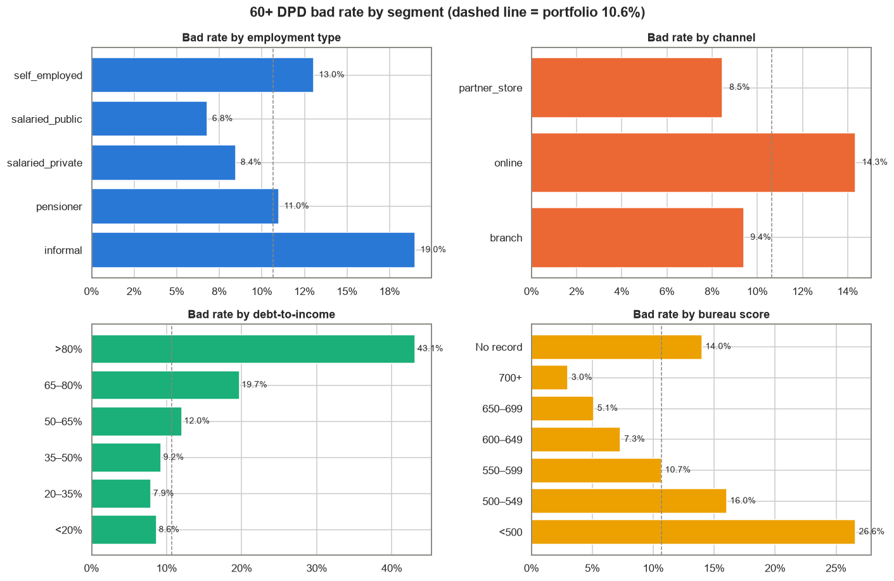
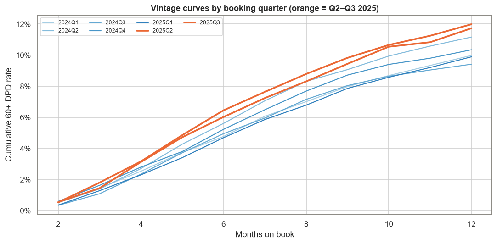
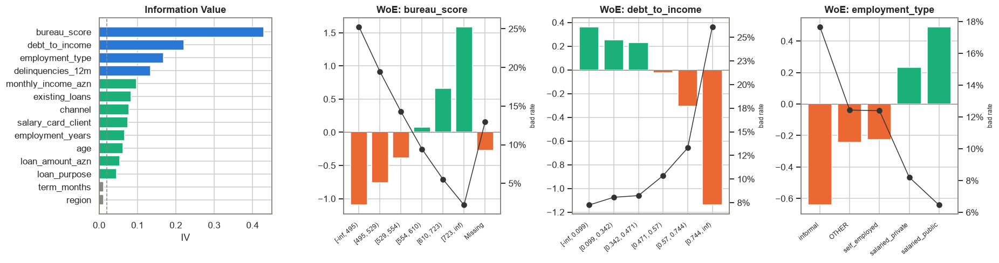
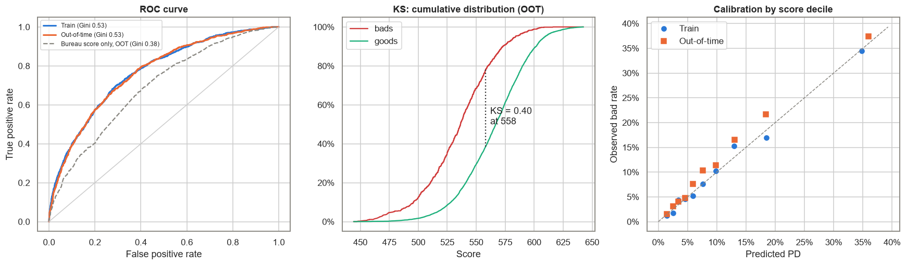
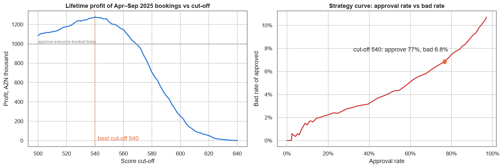
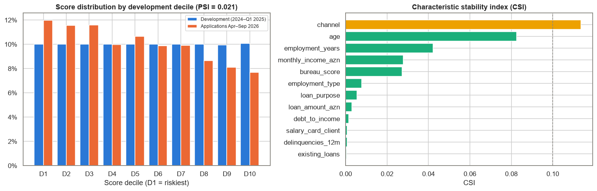

# Baku Microfinance — Credit Risk Scorecard

**Daily Data Analytics Project · Day 11**

## Business question
A Baku microfinance lender issues consumer loans (AZN 300–30,000, 6–36 months) through branches, an online app and partner stores. It approves applications with a single affordability rule: instalments ≤ 80% of income. About one loan in nine goes 60+ days past due. **Can an application scorecard rank risk well enough to set an approval cut-off that raises portfolio profit, and is the scorecard still valid for today's applicants?**

What the project does:
1. Cleans 24,045 booked loans (Jan 2024 – Sep 2025), each with a 12-month outcome: **bad = 60+ DPD within 12 months on book**.
2. KPIs and EDA: bad rate by segment and **vintage default curves**.
3. **Weight-of-Evidence binning** with monotonic bad-rate constraints and **Information Value** screening, written from scratch in pandas/NumPy.
4. **Logistic regression on WoE** → a points scorecard (600 points = 50:1 good:bad odds, PDO 20).
5. Validation on train, random test and **out-of-time** data (Apr–Sep 2025): Gini, KS, calibration, benchmark against the bureau score alone.
6. **Cut-off strategy** using simple loan unit economics: profit curve and approval-rate vs bad-rate trade-off.
7. **Stability monitoring:** PSI / CSI of 6,000 applications from Apr–Sep 2026 against the development sample.

## Key KPIs (from the executed notebook)
| KPI | Value |
|---|---|
| Booked loans / disbursed volume | 24,000 / AZN 74.0M (average loan AZN 3,085, median term 12 months) |
| Bad rate (60+ DPD in 12 months), count / volume | 10.65% / 9.57% |
| Estimated credit loss (EAD 80% × LGD 70%) | AZN 3.97M |
| Bad rate: Jan 2024–Mar 2025 vs Apr–Sep 2025 | 10.16% vs **11.86%** |
| Thin-file share (no bureau record) / their bad rate | 13.5% / 13.98% |
| Data cleaning | 45 duplicates dropped, 20 qəpik incomes fixed, 6 impossible ages + 24 impossible tenures set to missing |
| Characteristics in the scorecard | 12 of 14 (term and region dropped, IV < 0.02); strongest: bureau score IV 0.43 |
| Gini train / test / **out-of-time** | 0.535 / 0.522 / **0.531** |
| KS out-of-time | 0.40 (bureau score alone: Gini 0.38, KS 0.28) |
| OOT calibration | observed 11.9% vs predicted 10.3% → intercept shift +0.16 log-odds |
| Profit-maximising cut-off (OOT) | **540**: approve 76.6%, bad rate 11.86% → **6.85%** |
| Profit uplift vs current policy | AZN 0.997M → **AZN 1.275M (+27.9%)** |
| Declined at cut-off 540 | 1,601 loans, bad rate 28.2%, net loss avoided AZN 278k |
| Stability Apr–Sep 2026 | score PSI 0.021 (stable); channel CSI 0.114 (monitor); mean PD 10.2% → 11.2% |

## Charts
### Bad rate by segment


### Vintage curves


### Information Value and WoE patterns


### Validation: ROC, KS and calibration


### Cut-off strategy


### Population stability (2026 applications)


## Findings & recommendations
| Area | Evidence | Recommendation |
|---|---|---|
| Ranking power | OOT Gini 0.53 / KS 0.40 vs bureau score alone Gini 0.38 | Use the scorecard as the main decision tool; keep the bureau score as one input, not the whole policy |
| Cut-off | Cut-off 540: approve 77%, bad rate 11.9% → 6.8%, profit +28% | Introduce a score cut-off around 540, with a manual-review band of ±10 points |
| Affordability | Bad rate ~8% up to DTI 47%, then 13% at 57–74% and 26% above 74% | Tighten the instalment rule from 80% to ~60% of income, or price the extra risk |
| Thin file | 14% of loans, bad rate 14.0%; scorecard Gini on them 0.22 (the bureau score can't rank them at all) | Keep lending to thin files through the scorecard; add salary-card / payroll data to grow the segment safely |
| Calibration | 2025 Q2–Q3 vintages are worse: observed 11.9% vs predicted 10.3% | Recalibrate the intercept every quarter before using PD for pricing or IFRS 9 provisions |
| Population drift | Online grew from 29% to 45% of applications; channel CSI 0.11; share below cut-off 23% → 27% | Monthly PSI/CSI monitoring; review online acquisition and fraud checks |
| Early warning | Defaults peak in months 4–7; about half of 12-month bads are visible by month 6 | Track 3/6-month vintage bad rates to catch a bad vintage two quarters earlier |

**Bottom line:** a 12-characteristic WoE scorecard ranks risk clearly better than the bureau score and keeps that ranking on out-of-time data. A cut-off at 540 declines the lowest-scoring quarter of applicants (bad rate ≈ 28%) and raises profit by about 28%. The PD level moves with the market, so it should be recalibrated every quarter, with PSI watched as the applicant mix moves online.

*Caveats: outcomes exist only for approved loans (no reject inference). Unit economics are simplified: flat 13% net margin on an average balance of 55% of the amount; bad loans lose EAD 80% × LGD 70%; no early repayment.*

## Methods
- **Monotonic WoE binning** (`scorecard.bin_numeric`): start from 12 quantile bins (or one bin per value for discrete variables). Merge adjacent bins while the bad rate is not monotonic, a bin holds < 5% of rows, or there are more than 6 bins. Missing values get their own bin. Categories under 3% are grouped into OTHER.
- **WoE / IV:** `WoE = ln(%good / %bad)` with 0.5 smoothing; `IV = Σ (%good − %bad) · WoE`. Features need IV ≥ 0.02 and pairwise |WoE correlation| ≤ 0.6.
- **Model:** logistic regression on WoE values (scikit-learn). Every coefficient is checked to be negative, so higher WoE always means a safer applicant.
- **Scaling:** `Factor = PDO / ln 2`, `Offset = 600 − Factor · ln 50`. Points per attribute = `−(βᵢ·WoE + β₀/n) · Factor + Offset/n`.
- **Validation:** Gini = 2·AUC − 1, KS from the cumulative good/bad score distributions, calibration by development score decile. Split: train/test 70/30 random on Jan 2024–Mar 2025, out-of-time = Apr–Sep 2025.
- **Stability:** PSI on development score deciles; CSI on each characteristic's bins.

## Tech stack
Python · pandas · NumPy (**WoE binning, IV, KS, PSI written from scratch**) · scikit-learn (logistic regression, ROC/AUC) · matplotlib · seaborn · nbformat / nbconvert

## Structure
```
data/generate_data.py           synthetic loan generator (seed 42) with injected data issues
data/loans.csv                  24,045 raw booked loans with 12-month outcome
data/applications_recent.csv    6,000 Apr–Sep 2026 applications (no outcome yet) for stability checks
scorecard.py                    cleaning, monotonic WoE binning, IV, scaling, KS, PSI, unit economics
build_notebook.py               builds the analysis notebook
credit_risk_scorecard.ipynb     executed analysis
images/                         charts
```

## Run
```bash
pip install -r requirements.txt
python data/generate_data.py
python build_notebook.py
python -m nbconvert --to notebook --execute --inplace credit_risk_scorecard.ipynb
```

> **Note:** all data is synthetic (fixed random seed). It does not describe any real lender, customer or credit bureau.

## 🇦🇿 Azərbaycanca xülasə
Bakıdakı mikromaliyyə təşkilatının 24 min istehlak krediti (2024-cü ilin yanvarı – 2025-ci ilin sentyabrı, sintetik data) əsasında **kredit skorkartı** qurulub. "Pis" kredit 12 ay ərzində 60+ gün gecikmə deməkdir və ümumi pis kredit payı 10.65%-dir. Dəyişənlər monoton **WoE binning** ilə qruplaşdırılıb və **IV** ilə seçilib (ən güclüsü kredit bürosu balıdır, IV 0.43). Sonra logistik reqressiya qurulub və 600 bal = 50:1 əmsalı olan bal cədvəlinə çevrilib. Model zamandan kənar (out-of-time) yoxlamada da sabit qalır: **Gini 0.53**. Təkcə büro balının Gini-si 0.38-dir. **540 bal** həddi ilə müraciətlərin 77%-i təsdiqlənir, pis kredit payı 11.9%-dən **6.8%-ə** düşür, portfel mənfəəti isə təxminən **28%** artır. Əsas tövsiyələr: gəlirə nisbətdə ödəniş limitini 80%-dən ~60%-ə endirmək, PD-ni hər rüb yenidən kalibrləmək (2025-ci ilin kreditləri daha risklidir) və onlayn kanalın payı 29%-dən 45%-ə qalxdığı üçün PSI/CSI monitorinqini aylıq aparmaq.
